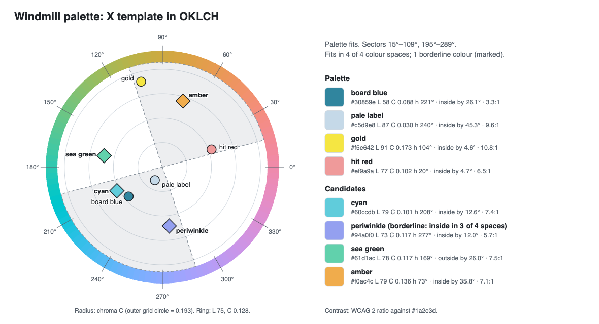
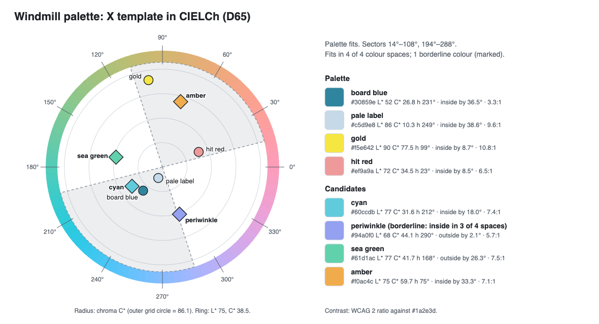
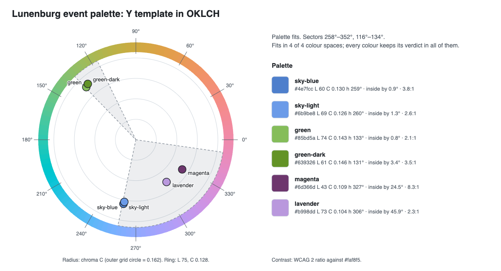
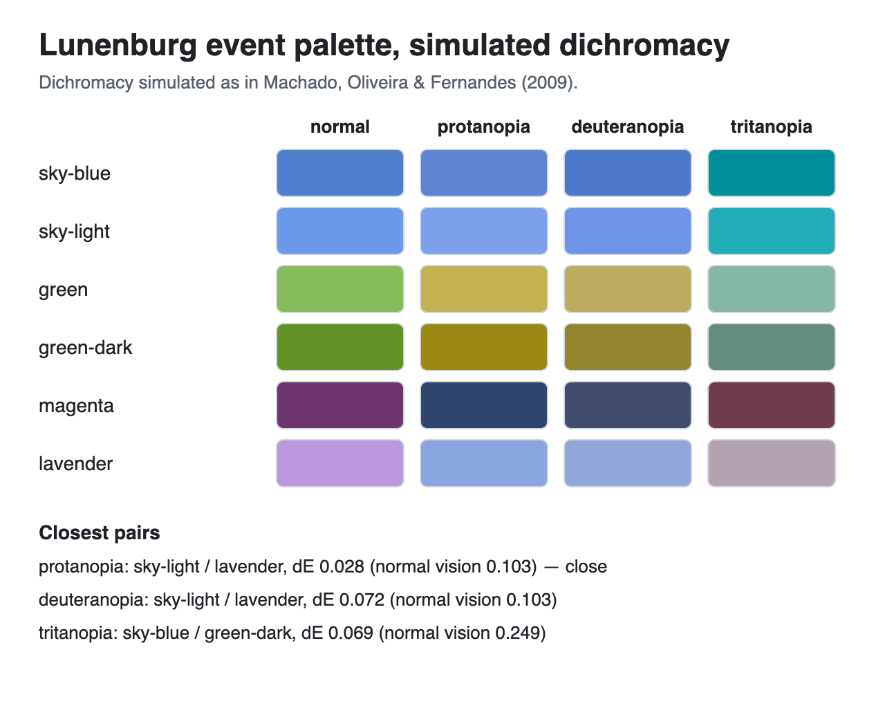
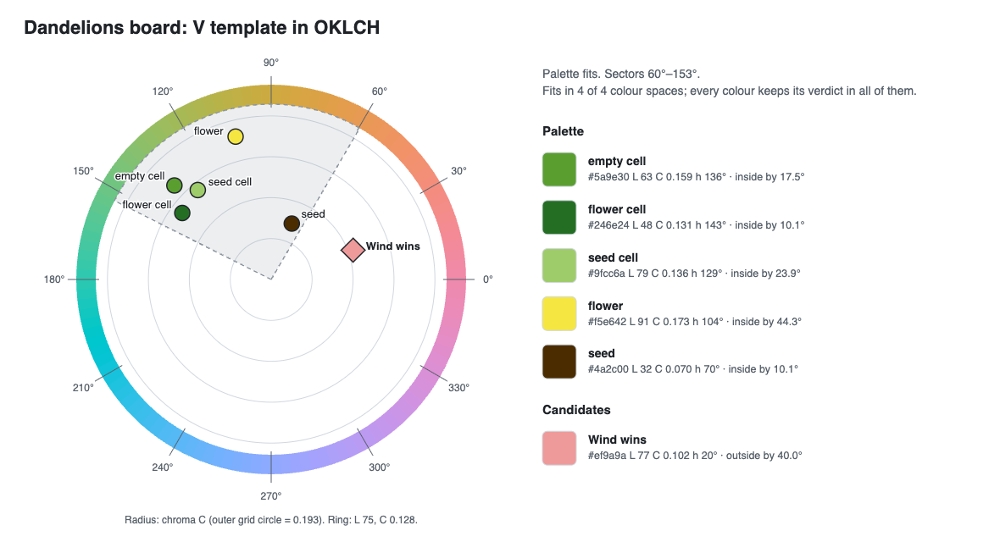
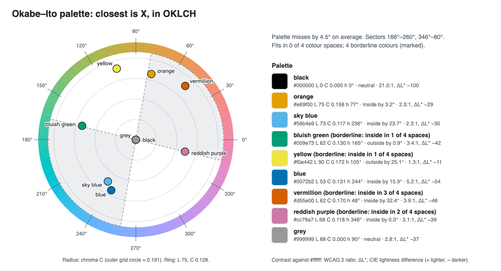
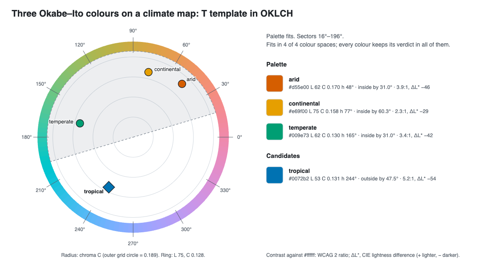
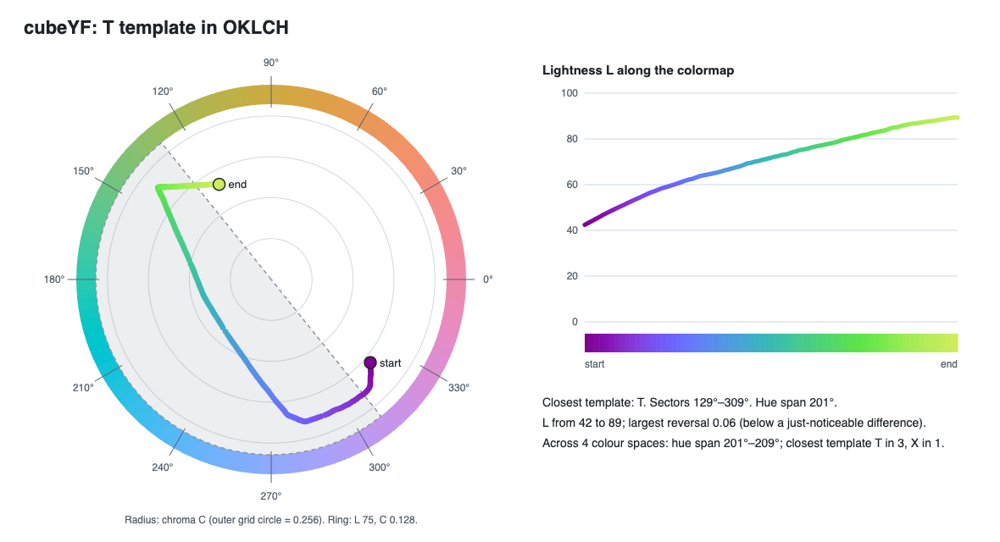
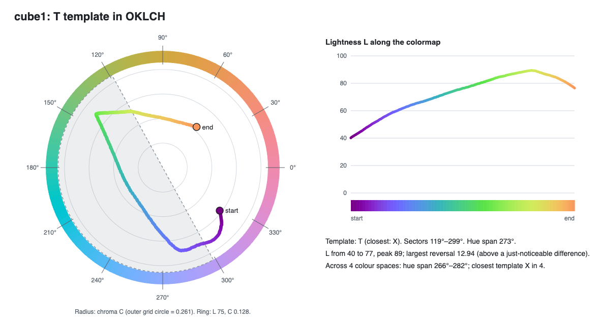
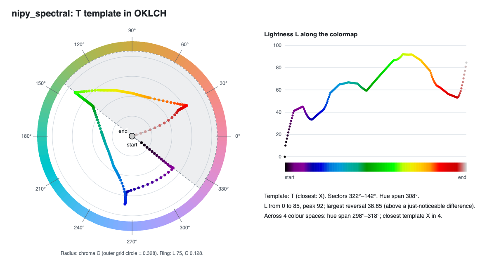

# perceptual-harmony

Check whether the colours of a palette are harmonious, measured in a perceptual colour space.

It is meant for anyone choosing a small set of distinct colours that must work together: the
palette of an app or a website, or the categories of a figure or map legend.

The tool fits the harmonic hue templates of Cohen-Or et al. (2006) to a palette. The templates
build on Matsuda's earlier work. Hue, lightness and chroma are measured in a perceptual colour
space (OKLCH by default), not in HSL or HSV, and each verdict is checked in several spaces. For
each colour the tool also reports lightness, chroma, its
colour difference to the nearest palette colour and, optionally, its contrast against a
background (the WCAG 2 ratio and the CIE lightness difference). It simulates the three dichromacies and flags colours that become hard to tell
apart. It can judge candidate colours against an existing palette, which is the usual
question when a design or a figure needs one more colour, and it can suggest some.

The library uses only the Python standard library (Python 3.9 or newer).

> Status: early development (0.1.0.dev0).

## Why measure harmony in a perceptual space

The harmonic templates are defined on a hue wheel, so the verdict depends on what "hue" means.
HSL and HSV hue are angles in a transformed RGB cube. Equal steps there are not equal steps of
perceived hue, so a colour can sit comfortably inside a template in HSL and outside it to the
eye. Perceptual spaces were built to make distances and angles track perception more closely.

They do not all agree, though, and the difference can change the answer. In the Windmill
example below, the same candidate colour is 12° inside the template in OKLCH and 2° outside it
in CIELCh. No space is the correct one, so the tool reports the margin in degrees, not just pass
or fail, and refits the template in several spaces. A colour that is inside in some and outside
in others is reported as borderline.

The templates are one model of harmony, and the report is information, not a rule. A colour
outside a template, or borderline, may still be the right choice. The designer's eye decides.

## Web page

[`docs/index.html`](docs/index.html) runs the same package in the browser, with
[Pyodide](https://pyodide.org). Paste colours or a CSS `:root` block, then check the palette or ask
for suggestions. It shows the hue wheel, the colour-vision swatches, the full report and the
suggestions as CSS. Nothing leaves the browser; the first visit downloads about 14 MB.

To try it locally, serve the folder, since browsers do not load the package from a `file://`
page:

```sh
python3 -m http.server --directory docs
```

then open <http://localhost:8000>. Adding `?example=windmill` (or `lunenburg`, `dandelions`,
`okabe`, `koppen`) loads an example. After changing the package, run `python docs/build_bundle.py`
to update the copy the page loads; the test suite checks that it is current.

## Install

From a clone of this repository:

```sh
pip install .
```

## Command line

```sh
perceptual-harmony check 'board blue=#30859e' 'pale label=#c5d9e8' 'gold=#f5e642' 'hit red=#ef9a9a' \
    -c 'periwinkle=#94a0f0' -c 'cyan=#60ccdb' \
    --background '#1a2e3d' --space oklch --svg wheel.svg
```

Colours are any CSS colour: hex, `rgb()`, `hsl()`, `hwb()`, `oklch()`, `oklab()`, `lab()`,
`lch()` or a named colour. Each can be labelled, as in `label=#hex` or `'accent=oklch(70% 0.12 250)'`.
Palette colours are positional. Each `-c` adds a candidate to judge against the palette.

A website's palette usually lives in its style sheet as custom properties. `--css` reads every
custom property whose value is a single colour; `-b` and `-c` then also accept property names:

```sh
perceptual-harmony check --css style.css --exclude 'ink*,paper*' -b paper -c 'new=oklch(70% 0.1 200)'
```

`var()` references are resolved. If a property is defined twice, for example again for a dark
theme, the first definition is used. Other options:

| option | meaning |
|---|---|
| `-s`, `--space` | `oklch` (default), `cielch`, `cam02ucs`, `cam16ucs` or `ipt` |
| `-t`, `--template` | judge against this template (`i V L I T Y X`) instead of the best-fitting one |
| `-r`, `--rotation` | fix the template's rotation, in degrees (the centre of its first sector) |
| `--css FILE` | read the palette from the colour custom properties of a style sheet |
| `--only`, `--exclude` | with `--css`: keep or drop properties by name, comma-separated, wildcards allowed |
| `-b`, `--background` | add WCAG 2 contrast ratios and CIE L* differences against this colour (with `--css`, may be a property name) |
| `--neutral-chroma` | chroma below which a colour counts as neutral and is ignored by the fit |
| `--robustness` | spaces in which to refit the template and compare verdicts, comma-separated, or `none` (default `oklch,cielch,cam16ucs,ipt`) |
| `--cvd-svg PATH` | also write swatches under simulated dichromacy |
| `--cvd-threshold` | colour difference below which a pair counts as close under simulated dichromacy |
| `--no-cvd` | skip the colour-vision-deficiency check |
| `--svg PATH` | also write the hue-wheel figure |
| `--json` | print the report as JSON |

`perceptual-harmony templates` lists the templates and their sectors.

## Suggesting colours

`perceptual-harmony suggest` takes the same palette options and proposes new colours:

```sh
perceptual-harmony suggest 'board blue=#30859e' 'pale label=#c5d9e8' 'gold=#f5e642' 'hit red=#ef9a9a' \
    -b '#1a2e3d' --min-contrast 4.5 -n 2
```

It searches a grid of OKLCH colours and keeps those that:

- sit inside the palette's template by at least `--min-margin` degrees (default 5) in the primary
  space, and inside it in every space of the robustness check;
- lie within the palette's range of lightness and chroma, slightly widened, or within the
  `--lightness` and `--chroma` ranges given;
- fit inside the sRGB gamut and, with `--min-contrast`, reach that WCAG 2 contrast against the
  background.

Of those, it takes the colour farthest from every palette colour, then repeats, each time also
staying far from the colours already suggested. The report judges the suggestions like any
candidate. It ends with CSS custom properties, ready to paste:

```css
  --new-1: oklch(66.0% 0.135 103);  /* #a29511 */
  --new-2: oklch(72.5% 0.140 271);  /* #86a0fe */
```

With `--cvd-safe`, each suggestion must also stay distinct from the palette, and from the
other suggestions, under all three simulated dichromacies.

To start a palette from scratch, give one colour and a template:

```sh
perceptual-harmony suggest '#30859e' -t X -n 4
```

The colour sits at the centre of one sector, and the suggestions fill the template around it.

The suggestions are options to look at, not answers. Distance from the palette is one goal
among several, and the designer's eye decides.

## Python

```python
from perceptual_harmony import check, render_svg

report = check(['#30859e', '#c5d9e8', '#f5e642', '#ef9a9a'],
               candidates=['periwinkle=#94a0f0'],
               space='cam02ucs', background='#1a2e3d')

report.chosen                 # best Fit: template, rotation, cost, sector ranges
report.fits                   # every template, best first
report.candidates[0].margin   # degrees inside (+) or outside (-) the template
report.candidates[0].robustness   # 'inside', 'outside' or 'borderline' across spaces
report.robustness             # the template refitted in each space
print(report.to_text())
open('wheel.svg', 'w').write(render_svg(report))
open('wheel_narrow.svg', 'w').write(render_svg(report, layout='narrow'))   # 640 px wide

from perceptual_harmony import suggest, css_block
report, found = suggest(['#30859e', '#c5d9e8', '#f5e642', '#ef9a9a'], n=2,
                        background='#1a2e3d', min_contrast=4.5)
print(css_block(found))       # --new-1: oklch(...);  /* #hex */
```

For a continuous colormap, `check_colormap` takes the ordered samples (hex strings or sRGB
triples in 0–1). It reports the closest template and its sectors, the hue span and the lightness
profile: the range, any interior peak or low, and the largest fall. `render_colormap_svg` draws
the samples as a path on the wheel, next to their lightness profile. Both give the same
measures in the other spaces of the robustness check.

There is no harmony score for a colormap. A colormap blends its colours, and a blend from one
sector of a template to another crosses the gap between them, so any score over the samples
counts the blends as misses. Windmill's five colours fit X exactly as a palette; blended in OKLab
into a colormap (ordered by lightness), the stretches between them are outside X by up to 40° in
OKLCH. The wheel shows where the path runs, and the hue span says how wide it is. To judge the
colours a colormap is built from, check its key colours as a palette with `check`. Lightness is
different: a colormap should be perceptually ordered, so its lightness is measured.

## Method

**Templates.** Cohen-Or et al. (2006) use eight of Matsuda's templates; the tool uses the
seven with hue sectors:

| | sectors |
|---|---|
| i | one 18° sector |
| V | one 93.6° sector |
| L | an 18° sector and a 79.2° sector, 90° apart |
| I | two opposite 18° sectors |
| T | one 180° sector |
| Y | a 93.6° sector and an opposite 18° sector |
| X | two opposite 93.6° sectors |

Matsuda's eighth template, N, is for greys and has no hue sector. A template may be rotated to
any angle.

**Fitting.** Each colour's distance to a template is the angle from its hue to the nearest
sector edge, or zero if its hue is inside a sector. Distances are weighted by chroma, as the
paper weights them by saturation. The cost is the chroma-weighted mean of the distances, in
degrees. For a given template the cost is piecewise linear in the rotation. Its minimum
therefore occurs where some hue sits exactly on a sector edge, and trying every such rotation
finds the global minimum exactly. When several rotations fit perfectly, the tool picks the one
whose worst-placed colour is furthest inside its sector. The best template is the one with the
lowest cost; ties go to the narrowest template. Wider templates fit more easily, so the report
lists every template, not only the best.

**Neutrals.** Hue is unstable and meaningless for colours near the grey axis. Colours with
chroma below a threshold are reported as neutral and left out of the fit. The default threshold
is 0.015 in OKLCH, 4 in CIELCh and 2.5 in CAM02-UCS.

**Colour spaces.**

- **OKLCH** (Ottosson 2020). Computed from sRGB.
- **CIELCh**. CIELAB with a D65 white. Its colour difference is CIE76 ΔE.
- **CAM02-UCS** (Luo, Cui & Li 2006), on CIECAM02. The viewing conditions match the defaults of
  the `colorspacious` package: adapting luminance 64/π/5 cd/m², background Y<sub>b</sub> = 20,
  average surround. The test suite checks the results against `colorspacious`.
- **CAM16-UCS** (Li et al. 2017), on CAM16, the successor of CIECAM02, with the same viewing
  conditions. The test suite checks reference values from `colour-science`.
- **IPT** (Ebner & Fairchild 1998), designed for uniform hue. It has no published
  just-noticeable difference. Its neutral threshold and rough JND are OKLCH's, scaled by the
  typical ratio between the two spaces.

**Robustness.** No colour space is the correct one for this. The spaces disagree on hue,
especially in the blues. The templates' sector widths are fractions of a hue wheel, not
measurements made in any of these spaces. A margin of a few degrees is therefore finer than the
model can resolve. So the tool refits the chosen template in several spaces and reports each
colour's margin in every one. By default it uses OKLCH, CIELCh, CAM16-UCS and IPT: one space from
each design family, with CAM16-UCS standing in for CAM02-UCS. They were chosen for that reason,
not for the results they give. A colour inside the template in every space is a robust fit; one
that changes sides is borderline.

OKLCH is the default primary space because it was designed for hue linearity, and because CSS
writes colours as `oklch()`, which suits the intended audience.

**Distinctness and contrast.** For each colour the tool reports the nearest palette colour and
the Euclidean colour difference to it, in the chosen space. The report also gives a rough
just-noticeable difference for each space. With a background, it reports two measures of
contrast against it:

- the WCAG 2 contrast ratio (1 to 21), the measure most accessibility rules refer to;
- the CIE L* difference, colour minus background: positive when the colour is lighter, negative
  when it is darker. L* depends on luminance alone, as the WCAG ratio does, but on a perceptual
  scale from 0 to 100, and its sign says which way the contrast runs. It does not depend on the
  colour space chosen for the report.

Both are information, not a verdict. The tool sets no threshold except the one you pass to
`--min-contrast`, which uses the WCAG 2 ratio.

APCA, the contrast method proposed for WCAG 3, is not included. Its reference implementation is
licensed for web content under WCAG only, the name may be used only by implementations that
follow its current official version, and other uses fall under the AGPL
([licence](https://github.com/Myndex/apca-w3/blob/master/LICENSE.md)). That does not fit an MIT
package also meant for printed figures and maps. Its official tools can be used alongside this one.

**Colour-vision deficiency.** The tool simulates protanopia, deuteranopia and tritanopia with
the matrices of Machado, Oliveira & Fernandes (2009) at full severity, applied in linear sRGB,
as the `colorspacious` package does. The test suite checks the results against it. For each
dichromacy the report lists the pairs of colours that come closest, with their colour
difference beside the normal-vision value. Pairs below three times the space's rough
just-noticeable difference are flagged as close. The threshold is a rough guide: thin lines and
small marks need more difference than large areas.

**The figure.** The wheel is the a–b plane of the chosen space, with +a to the right and hues
counter-clockwise. Each colour sits at a radius proportional to its chroma. The outer ring is
drawn at one lightness and one chroma for every hue (the most colourful ring that stays inside
the sRGB gamut), so the ring itself is perceptually even.

## Worked example: Windmill

[`examples/windmill.py`](examples/windmill.py) comes from choosing one more colour for the game
Windmill. The colour marks 8 added wind directions in the replay compass. It had to be clearly
different from the ocean blues already on screen and still sit well with the palette.

The palette fits the X template in all three spaces. The blues fill one sector, and the gold
and the red fill the opposite one. The first candidate, cyan, falls among the blues and is too
similar to them. Periwinkle sits near the far edge of the blue sector. It is clearly different,
yet still inside the template in OKLCH (by 12°) and CAM02-UCS (by 19°). In CIELCh it is 2°
outside, which is the space dependence described above. The robustness check reports it as
borderline: inside in three of four spaces. The palette itself fits X in all four.

Asked for two colours with at least 4.5:1 contrast on the compass background,
`perceptual-harmony suggest` proposes `#86a0fe` as the second. It is within one just-noticeable
difference of the periwinkle chosen by eye: the same lightness, a little more chroma, 6° of hue
apart.

| OKLCH | CIELCh |
|---|---|
|  |  |

## Worked example: a palette picked from a watercolour

[`examples/lunenburg.py`](examples/lunenburg.py) checks the event palette of
[lunenburg.fingerpost.ca](https://lunenburg.fingerpost.ca), a community events site. Its colours
were picked from the page banner, a watercolour of a Lunenburg house:

- two blues from the sky;
- two greens from the clapboard;
- a magenta and a lavender from the tower.

The watercolour's colours were chosen by eye while painting. The real house is blue, white and
grey.

The script reads the colours straight from the site's style sheet
([`examples/data/lunenburg.css`](examples/data/lunenburg.css)), leaving out the ink and paper
neutrals. On the command line:

```sh
perceptual-harmony check --css examples/data/lunenburg.css --exclude 'ink*,paper*' -b paper
```

The palette is harmonious. In OKLCH it fits the Y template exactly: the greens fill the narrow
sector, and the blues, magenta and lavender fill the wide one. It also fits X exactly, and it
fits in CIELCh and CAM02-UCS too. The blues sit only about 1° inside the edge of Y's wide
sector, so X gives the palette more room.



Under simulated protanopia, sky-light and lavender come close: their colour difference drops from
0.103 to 0.028. The other pairs stay apart under all three dichromacies.



## Worked example: a meadow game

[`examples/dandelions.py`](examples/dandelions.py) checks the board of the game
[Dandelions](https://github.com/mycarta/Dandelions). The cells are three greens, for empty,
flower and seed squares. The symbols on them are a gold flower and a brown seed. The colours come
from the game's style sheet.

All five fall within one band of yellows and greens, about 75° wide, so the board fits the
narrow V template. The fit holds in all four spaces of the robustness check, every colour at
least 10° inside. The pink of the "Wind wins" message sits 30–42° outside, apart from the meadow,
like an alert colour.



## Worked example: Okabe–Ito, a palette built for distinction

The Okabe–Ito palette (Okabe & Ito 2008) was designed so that categories stay distinct for
readers with colour-vision deficiencies. Claus Wilke calls it "my preferred qualitative color
scale" and uses it throughout *Fundamentals of Data Visualization* (2019). Since R 4.0 it is the
default of `palette.colors()`, so R users can check it straight from R:

```sh
perceptual-harmony check $(Rscript -e 'p <- palette.colors(); cat(paste0(names(p), "=", p))')
```

[`examples/okabe_ito.py`](examples/okabe_ito.py) runs the same check. No template fits the seven
hues in any of the four spaces. X comes closest, missing by 4.5° on average in OKLCH, and its best
rotation moves from space to space. Four colours change sides between spaces. That is by design:
to keep seven hues apart, the palette spreads them around the wheel. Harmony is not its goal, and
the report describes this without judging the palette.

Its goal shows in the colour-vision check. Under the three simulated dichromacies no two of the
seven hues come close; the closest pair stays at 0.076. The grey that R adds as a ninth colour
is another matter: under simulated deuteranopia it comes within 0.019 of reddish purple, and
under protanopia within 0.054 of bluish green.

A few colours chosen from it can be harmonious, though. Sink & Brikowski (2025, Fig. 2) map the
Köppen–Geiger climate classes of the contiguous US with three Okabe–Ito colours: vermillion for
arid, orange for continental and bluish green for temperate. A blue marks a small tropical area
in Florida. The three fit the T template in all four spaces, each at least 29° inside. The blue
sits 44–66° outside, set apart like the extra class it is.

| Okabe–Ito, as in R | Three of its colours on a climate map |
|---|---|
|  |  |

## Worked example: cubeYF and cube1, 2013 revisited

[`examples/cubeyf.py`](examples/cubeyf.py) measures the hue spread of cubeYF, a perceptual
rainbow colormap built in CIELAB with a monotonic lightness profile (see
[Background](#background)). In 2013 its hue spread was judged by eye: it "looks very close to a
T template rotated by 180 degrees", "also exceeding a bit 180 degrees". The tool now puts numbers
on that.

- The hues span 201° in OKLCH, 206° in CAM02-UCS and 209° in CIELCh: a little more than the 180°
  of T, as the post said. T is the closest template in OKLCH and CAM02-UCS, X in CIELCh.
- Across the four spaces of the robustness check, the hues span 201–209°.
- Lightness rises at every step except a fall of 0.12 L\* near the bright end, far below a
  just-noticeable difference. In CIELAB it runs from L\* 30 to 89.

The same post offered cube1 as an alternative with "a slightly superior visual hue contrast",
"due to the addition of a red-like color at the high lightness end", "at the cost of a modest
deviation from 100% perceptual". The numbers show the trade:

- cube1's hues span 273° in OKLCH (269° in CIELCh), 60–70° more than cubeYF's and far beyond
  the 180° of T. Across the four robustness spaces the span is 266–282°.
- Lightness rises to a peak of L\* 89 at the yellow-green and then falls to 71 at the orange end. That
  fall of 18 L\* is where cube1 departs from a monotonic profile.

The same post also placed jet in a T template; its hues span 235° in OKLCH, and its lightness
rises and falls by 58 points. The post's comparison also included an industry spectrum colormap.
Matplotlib's `nipy_spectral`, a similar spectrum (called `spectral` before matplotlib 2.0),
stands in for it here. It is also the spectral colormap that the *Leading Edge* tutorial
(Niccoli 2014, see [Background](#background)) takes apart. Its hues span 298–318° across the
four spaces, and its lightness rises and falls several times, by up to 50 L\*. For a colormap,
harmony is a secondary property: the lightness profile comes first. So each figure shows both.

| cubeYF | cube1 |
|---|---|
|  |  |



The cubeYF and cube1 samples in [`examples/data/cubeyf.csv`](examples/data/cubeyf.csv) and
[`examples/data/cube1.csv`](examples/data/cube1.csv) are reused with permission. Please credit
Matteo Niccoli and mycartablog.com.

## Background

The method continues earlier work on perceptual colour by Matteo Niccoli on the MyCarta blog.
In particular:

- Matteo Niccoli, *The rainbow is dead…long live the rainbow! – Perceptual palettes, part 3*,
  MyCarta, 6 October 2012.
  <https://mycartablog.com/2012/10/06/the-rainbow-is-deadlong-live-the-rainbow-part-3/>
- Matteo Niccoli, *Perceptual rainbow palette – the method*, MyCarta, 21 February 2013.
  <https://mycartablog.com/2013/02/21/perceptual-rainbow-palette-the-method/>
- Matteo Niccoli, *Perceptual rainbow palette – the goodies*, MyCarta, 6 March 2013.
  <https://mycartablog.com/2013/03/06/perceptual-rainbow-palette-the-goodies/>

Part 3 traces the false edges seen in rainbow colormaps to inflection points in their lightness
profile. That is why `check_colormap` reports falls in lightness and interior peaks and lows.
The method post builds cubeYF in CIELAB, with a monotonic, perceptually ordered lightness
profile, and the goodies post presents it. The goodies post's "mood" section already used the
harmonic templates of Cohen-Or et al. to judge cubeYF's hue spread, which "looks very close to a
T template rotated by 180 degrees". This library automates that kind of judgement and makes it
perceptual.

The same perceptual approach to evaluating colours is set out as a tutorial, with a Jupyter
notebook, in *The Leading Edge*'s Geophysical tutorial series:

- Niccoli, M. (2014). Evaluate and compare colormaps. *The Leading Edge* 33(8), 910–912.
  <https://doi.org/10.1190/tle33080910.1>. Notebook:
  <https://github.com/seg/tutorials-2014/tree/master/1408_Evaluate_and_compare_colormaps>

## References

- Cohen-Or, D., Sorkine, O., Gal, R., Leyvand, T., Xu, Y.-Q. (2006). Color harmonization.
  *ACM Transactions on Graphics* 25(3), 624–630 (Proc. SIGGRAPH 2006).
  <https://igl.ethz.ch/projects/color-harmonization/harmonization.pdf>
- Matsuda, Y. (1995). *Color design*. Asakura Shoten.
- Okabe, M., Ito, K. (2008). Color Universal Design (CUD): how to make figures and presentations
  that are friendly to colorblind people. <https://jfly.uni-koeln.de/color/>
- Wilke, C. O. (2019). *Fundamentals of Data Visualization*. O'Reilly.
  <https://clauswilke.com/dataviz/>
- Zeileis, A., Murrell, P. (2023). Coloring in R's blind spot. *The R Journal* 15(3), 240–256.
  <https://doi.org/10.32614/RJ-2023-071>
- Sink, K., Brikowski, T. (2025). Toward merging MOPEX and CAMELS hydrometeorological datasets:
  compatibility and statistical comparison. *Hydrology and Earth System Sciences* 29, 4015–4054.
  <https://doi.org/10.5194/hess-29-4015-2025>
- Machado, G. M., Oliveira, M. M., Fernandes, L. A. F. (2009). A physiologically-based model
  for simulation of color vision deficiency. *IEEE Transactions on Visualization and Computer
  Graphics* 15(6), 1291–1298. <https://doi.org/10.1109/TVCG.2009.113>
- Ottosson, B. (2020). A perceptual color space for image processing.
  <https://bottosson.github.io/posts/oklab/>
- Moroney, N., Fairchild, M. D., Hunt, R. W. G., Li, C., Luo, M. R., Newman, T. (2002).
  The CIECAM02 color appearance model. *Proc. IS&T/SID 10th Color Imaging Conference*, 23–27.
- Li, C., Li, Z., Wang, Z., Xu, Y., Luo, M. R., Cui, G., Melgosa, M., Brill, M. H., Pointer, M.
  (2017). Comprehensive color solutions: CAM16, CAT16, and CAM16-UCS. *Color Research &
  Application* 42(6), 703–718.
- Ebner, F., Fairchild, M. D. (1998). Development and testing of a color space (IPT) with
  improved hue uniformity. *Proc. IS&T/SID 6th Color Imaging Conference*, 8–13.
- Luo, M. R., Cui, G., Li, C. (2006). Uniform colour spaces based on CIECAM02 colour appearance
  model. *Color Research & Application* 31(4), 320–330.
- W3C (2018). Web Content Accessibility Guidelines (WCAG) 2.1: contrast ratio.
  <https://www.w3.org/TR/WCAG21/#dfn-contrast-ratio>
- CIE (2018). *Colorimetry*, 4th edition. CIE 015:2018 (CIELAB and L*).

## Development

```sh
python3 -m venv .venv
.venv/bin/pip install -e '.[dev]'
.venv/bin/python -m pytest
```

## Licence

MIT. See [LICENSE](LICENSE).
